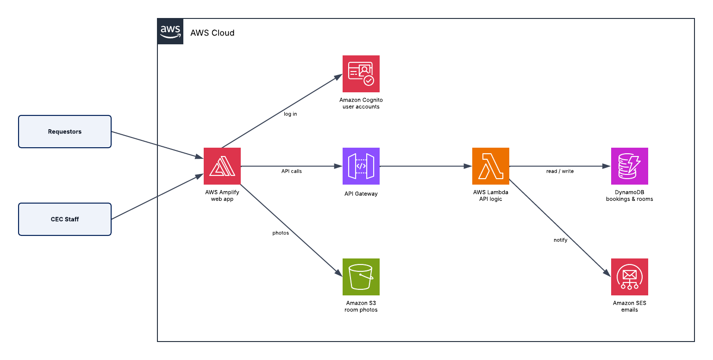

# SpaceBook

**Landing page:** [pitt-cic.github.io/SpaceBook](https://pitt-cic.github.io/SpaceBook/)

| Index                         | Description                                         |
|:------------------------------|:----------------------------------------------------|
| [Overview](#overview)         | See what this project does and its key capabilities |
| [Demo](#demo)                 | View the demo video                                 |
| [Description](#description)   | Learn about the problem and our approach            |
| [Architecture](#architecture) | View the system architecture diagram                |
| [Tech Stack](#tech-stack)     | Technologies and services used                      |
| [Deployment](#deployment)     | How to install and deploy the solution              |
| [Usage](#usage)               | How to use the application                          |
| [Costs](#costs)               | Estimated AWS costs for running the solution        |
| [Credits](#credits)           | Meet the team behind this project                   |
| [License](#license)           | See the project's license information               |
| [Disclaimers](#disclaimers)   | Important legal disclaimers                         |

---

# Overview

**SpaceBook** is a serverless room-booking platform for the University of Pittsburgh's Community Engagement Centers
(CECs). Community organizations request meeting space online, CEC staff review and approve requests, and requestors
track their own bookings through a passwordless email sign-in.

It replaces an email-and-phone process with a single shared system. Staff see live room availability (setup and
cleanup time included), and double-bookings are prevented automatically. The whole stack runs on AWS managed
services for about $7–9 a month.

**Key capabilities include:**

- **Filter-First Request Form**: Requestors enter their date, time, headcount, and tech needs, then choose from only
  the rooms that fit
- **Staff Review Workflow**: Approve into any room, deny, counter-propose a new time or room, and handle cancellations
- **Conflict-Proof Booking**: A transactional slot lock at approval time makes it impossible to double-book a room
- **Requestor Self-Service**: One-time email codes (no passwords) let requestors check status, cancel, or respond to
  counter-proposals
- **Multi-Site Administration**: Admins manage sites, rooms, photos, and staff access from the app, with no redeploy
- **Calendar Integration**: Confirmed bookings send Outlook/Google calendar invites, and staff can subscribe to a
  personal `.ics` feed
- **Accessible**: Built and audited to WCAG 2.2 AA, as required by Pitt Policy CS 26

---

# Demo


https://github.com/user-attachments/assets/32eb4793-24f7-460b-8b90-98b7df1b80b5


<!-- https://github.com/user-attachments/assets/[asset-id] -->

---

# Description

## Problem Statement

CECs lend their meeting rooms to neighborhood groups, nonprofits, and university programs, but requests arrived by
email and phone and were tracked by hand. Without a shared, live view of which rooms were free, double-bookings and
slow back-and-forth were common, and requestors had to contact staff just to check a request's status. That process
doesn't scale as the program expands to more sites.

## Our Approach

**Guided Requests with Server-Side Enforcement**: The request form shows only rooms that match the requestor's
needs and are free. The real guarantee is on the backend. Approving a request writes the booking and a lock for each
15-minute slot it occupies in a single DynamoDB transaction, so overlapping approvals fail instead of
double-booking.

**Two Audiences, Two Sign-In Pools**: Staff and admins sign in with passwords to one Amazon Cognito pool, and
per-site groups control their access. Requestors use a separate pool with a passwordless email-code flow. Their
account is created automatically when they first submit a request.

**Serverless Infrastructure**: A single AWS CDK stack deploys API Gateway (protected by AWS WAF), Python Lambda
functions, DynamoDB, Cognito, SES, and Amplify Hosting. Nothing runs between requests, so the stack costs only a few
dollars a month at CEC scale.

## Testing & Validation

The backend has pytest unit tests and `moto`-mocked AWS integration tests for every transactional and Cognito path.
The infrastructure has CDK assertion tests. Every page, menu, and modal was scanned with axe-core against WCAG 2.2 AA
(0 violations) and checked by hand for keyboard use and 320 px reflow.

---

# Architecture



---

# Tech Stack

| Category     | Technology                                                         | Purpose                                                  |
|:-------------|:-------------------------------------------------------------------|:---------------------------------------------------------|
| **Frontend** | [React](https://react.dev/) + [TypeScript](https://www.typescriptlang.org/) | User interface                                  |
|              | [Vite](https://vite.dev/)                                          | Build tool and dev server                                |
|              | [Tailwind CSS](https://tailwindcss.com/)                           | Styling                                                  |
| **Backend**  | [Python](https://www.python.org/)                                  | Lambda function runtime                                  |
| **AWS**      | [Lambda](https://aws.amazon.com/lambda/)                           | Serverless API handlers and notifications                |
|              | [API Gateway](https://aws.amazon.com/api-gateway/)                 | REST API endpoint                                        |
|              | [WAF](https://aws.amazon.com/waf/)                                 | Rate limiting on public endpoints                        |
|              | [DynamoDB](https://aws.amazon.com/dynamodb/)                       | Bookings, rooms, and sites                               |
|              | [Cognito](https://aws.amazon.com/cognito/)                         | Staff login and passwordless requestor login             |
|              | [SES](https://aws.amazon.com/ses/)                                 | Sign-in codes, status emails, and calendar invites       |
|              | [S3](https://aws.amazon.com/s3/) + [CloudFront](https://aws.amazon.com/cloudfront/) | Room photo storage and delivery         |
|              | [Amplify Hosting](https://aws.amazon.com/amplify/)                 | Frontend hosting                                         |
| **IaC**      | [AWS CDK](https://aws.amazon.com/cdk/)                             | Infrastructure as code                                   |

---

# Deployment

For full setup, deployment, and local development instructions, see the [Developer Guide](DEVELOPER_GUIDE.md).

## Quick Start

1. Install the prerequisites: Node.js 24, Python 3.13 (for `pip3`), the AWS CLI, `zip`, and `curl`
   (Docker is optional; it's only used if `pip3` isn't available)
2. Configure AWS credentials (`aws configure` or `aws configure sso`) and verify an SES sender email
   (the deploy script asks for it the first time you deploy a stack)
3. Deploy everything (infrastructure, then frontend) with one command from the repo root:

   ```bash
   ./deploy.sh                       # production (asks for confirmation)
   ./deploy.sh --dev <yourname>      # your personal dev stack
   ```

   The script checks prerequisites, confirms your AWS identity, deploys the CDK stack, builds the frontend
   against the stack's outputs, uploads it to Amplify, and prints the app URL.

### deploy.sh options

```plaintext
--dev NAME                Developer name (required for dev/beta stages)
--stage STAGE             dev, beta, or prod (default: prod, or dev when --dev is given)
--profile NAME            AWS CLI profile name
--ses-sender-email EMAIL  SES-verified From address (otherwise reused from the stack or prompted for)
--branch NAME             Amplify branch to deploy (default: main)
--skip-bootstrap          Skip CDK bootstrap (after the first deploy in an account/region)
--require-approval LEVEL  never, any-change, or broadening (default: broadening)
--skip-build              Deploy the existing frontend/dist/ without rebuilding
--no-wait                 Don't wait for the Amplify deployment to finish
--infra-only              Deploy infrastructure only
--frontend-only           Deploy frontend only (infrastructure must already exist)
--yes / -y                Skip confirmation prompts
```

To deploy the pieces separately, run `npm run deploy` in `infra/` and then in `frontend/` (see the
[Developer Guide](DEVELOPER_GUIDE.md)).

Calendar invites are off by default. See [Calendar Invites](DEVELOPER_GUIDE.md#calendar-invites-optional) to turn
them on.

---

# Usage

1. **Access the Application**: `deploy.sh` prints the app URL. The public request form is at `/`,
   and staff sign in at `/login`.

2. **Create the First Admin**: Create a user in the staff Cognito pool and add them to the `admin` group (see the
   [Developer Guide](DEVELOPER_GUIDE.md#signing-in)). They'll receive a temporary password by email and set a new one
   on first login.

3. **Set Up Sites and Rooms**: Under **Manage Sites** and **Manage Rooms**, add each site and its rooms (capacity,
   equipment, open hours, photos). Use **Staff Access** to invite staff and give them access to their sites.

4. **Submit a Request**: Requestors fill out the public form, choose from the matching rooms, and get a
   confirmation email.

5. **Review Requests**: Staff open **Manage Requests** to approve, deny, or counter-propose. The **Dashboard** shows
   pending approvals and today's schedule.

6. **Track Requests**: Requestors sign in to **My Requests** with a one-time email code to check status, cancel, or
   respond to a counter-proposal.

7. **View the Calendar**: **Room Availability** shows week and month views. **Subscribe in Outlook** adds a
   personal calendar feed of your sites' bookings.

---

# Costs

## Estimated Monthly Costs

| Service         | Estimated Cost | Notes                                                    |
|:----------------|---------------:|:---------------------------------------------------------|
| AWS WAF         |          $7.00 | $5 per web ACL + $1 per rule (2 rules); fixed cost       |
| API Gateway     |           <$1 | $3.50 per million requests                               |
| Lambda          |           <$1 | Free tier covers 1M requests/month                       |
| DynamoDB        |           <$1 | On-demand; storage within the 25 GB free tier            |
| SES             |           <$1 | $0.10 per 1,000 emails                                   |
| Cognito         |            ~$0 | Free tier covers 10,000 MAUs                             |
| Amplify, S3, CloudFront |    ~$0 | Small static site and room photos                       |
| **Total**       |  **~$7–9/month** | Almost entirely WAF; usage adds cents                  |

## Estimated Costs by Usage

| Scenario    | Sites | Staff | Requests/month | Monthly Cost |
|:------------|------:|------:|---------------:|-------------:|
| **Pilot**   |     1 |     5 |             50 |       ~$7.10 |
| **Typical** |     3 |    15 |            300 |       ~$7.40 |
| **Busy**    |     8 |    40 |          1,500 |       ~$8.40 |

## Estimated Per-Action Costs

| Action                                     |    Cost |
|:-------------------------------------------|--------:|
| One booking request, submitted to approved | ~$0.0005 |
| One staff member, per month                |   ~$0.01 |

> **Note:** Estimates use US East (N. Virginia) pricing as of October 2026 and assume no free tier beyond what's
> noted. Each deployed stack (including personal dev stacks) has its own $7/month WAF charge. Actual costs may vary
> by region and usage.

---

# Credits

**SpaceBook** is an open-source project developed by the University of Pittsburgh Health Sciences and Sports
Analytics Cloud Innovation Center.

**Development Team:**

- [Matthew Lu](https://www.linkedin.com/in/matthewlu2/)
- [Tanishq Bansod](https://www.linkedin.com/in/tanishq-bansod/)

**Project Leadership:**

- **Technical Lead:** [Maciej Zukowski](https://www.linkedin.com/in/maciejzukowski/) — Solutions Architect, Amazon Web Services (AWS)
- **Program Manager:** [Kate Ulreich](https://www.linkedin.com/in/kate-ulreich-0a8902134/) — Program Leader, University of Pittsburgh Health Sciences and Sports Analytics Cloud Innovation Center

**Special Thanks:**

- [Keith Caldwell](https://www.linkedin.com/in/keith-caldwell-6a4a515/) — Executive Director of Place-Based Initiatives, University of Pittsburgh Office of Engagement & Community Affairs

This project is designed and developed with guidance and support from the
[Health Sciences and Sports Analytics Cloud Innovation Center, powered by AWS](https://digital.pitt.edu/cic).

---

# License

This project is licensed under the [MIT License](./LICENSE).

```plaintext
MIT License

Copyright (c) 2026 University of Pittsburgh Health Sciences and Sports Analytics Cloud Innovation Center

Permission is hereby granted, free of charge, to any person obtaining a copy
of this software and associated documentation files (the "Software"), to deal
in the Software without restriction, including without limitation the rights
to use, copy, modify, merge, publish, distribute, sublicense, and/or sell
copies of the Software, and to permit persons to whom the Software is
furnished to do so, subject to the following conditions:

The above copyright notice and this permission notice shall be included in all
copies or substantial portions of the Software.

THE SOFTWARE IS PROVIDED "AS IS", WITHOUT WARRANTY OF ANY KIND, EXPRESS OR
IMPLIED, INCLUDING BUT NOT LIMITED TO THE WARRANTIES OF MERCHANTABILITY,
FITNESS FOR A PARTICULAR PURPOSE AND NONINFRINGEMENT. IN NO EVENT SHALL THE
AUTHORS OR COPYRIGHT HOLDERS BE LIABLE FOR ANY CLAIM, DAMAGES OR OTHER
LIABILITY, WHETHER IN AN ACTION OF CONTRACT, TORT OR OTHERWISE, ARISING FROM,
OUT OF OR IN CONNECTION WITH THE SOFTWARE OR THE USE OR OTHER DEALINGS IN THE
SOFTWARE.
```

---

For questions, issues, or contributions, please visit our [GitHub repository](https://github.com/pitt-cic/SpaceBook) or
contact the development team.

---

# Disclaimers

**Customers are responsible for making their own independent assessment of the information in this document.**

**This document:**  
(a) is for informational purposes only,  
(b) references AWS product offerings and practices, which are subject to change without notice,  
(c) does not create any commitments or assurances from AWS and its affiliates, suppliers or licensors. AWS products or
services are provided "as is" without warranties, representations, or conditions of any kind, whether express or
implied. The responsibilities and liabilities of AWS to its customers are controlled by AWS agreements, and this
document is not part of, nor does it modify, any agreement between AWS and its customers, and  
(d) is not to be considered a recommendation or viewpoint of AWS.

**Additionally, you are solely responsible for testing, security and optimizing all code and assets on GitHub repo, and
all such code and assets should be considered:**  
(a) as-is and without warranties or representations of any kind,  
(b) not suitable for production environments, or on production or other critical data, and  
(c) to include shortcuts in order to support rapid prototyping such as, but not limited to, relaxed authentication and
authorization and a lack of strict adherence to security best practices.

**All work produced is open source. More information can be found in the GitHub repo.**
